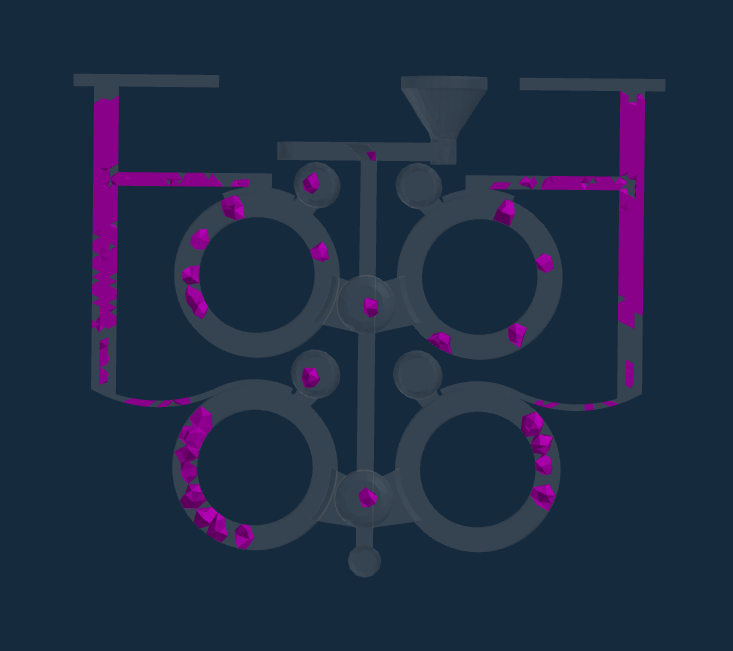
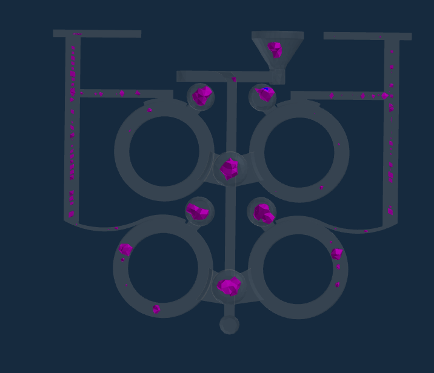
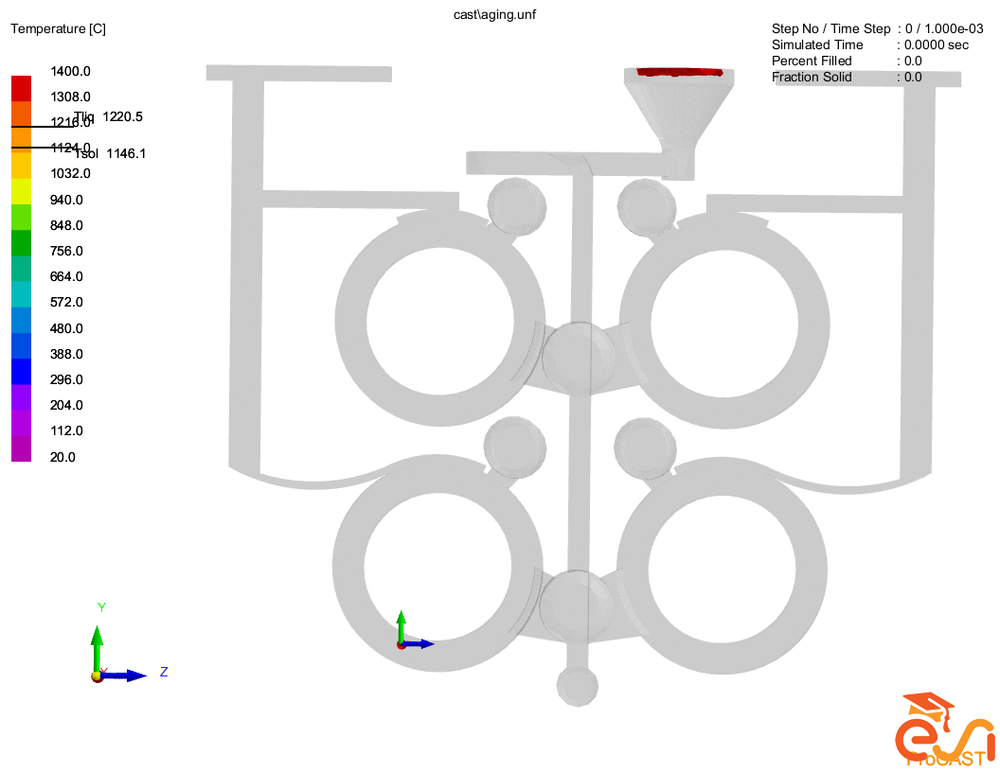

# ProCAST Casting Simulation: Shrinkage and Hot Spot Analysis

## Project Overview

This project investigates casting defects in a four-cavity ring-shaped casting system using ProCAST.

The objective is to identify shrinkage-prone regions, analyze hot spots, determine which casting cavity is most susceptible to defects, and propose corrective measures.

## Simulation Setup

- **Software:** ProCAST
- **Process:** Casting and solidification
- **Geometry:** Four ring-shaped cavities
- **Material:** Gray cast iron
- **Pouring temperature:** 1400 °C

## 1. Hot Spot Analysis

Hot spot analysis is used to identify regions that remain hot during solidification and may be susceptible to shrinkage if feeding is insufficient.

## 2. Shrinkage Analysis

The shrinkage results indicate potential shrinkage defects in the casting. The lower rings and their outer walls are important regions for further investigation.

## 3. Simulation Animation

The following animation illustrates the simulated casting process.

## 4. Proposed Defect Mitigation Strategies

- **Improve riser feeding:** Increase the riser neck cross-section to delay premature solidification of the feeding path.
- **Increase riser efficiency:** Evaluate insulating or exothermic materials around the risers.
- **Improve feeding of the lower cavities:** Consider additional side risers or local feeding arrangements.
- **Apply chills:** Evaluate metallic chills near shrinkage-prone regions to promote directional solidification.
- **Optimize pouring temperature:** Investigate a lower pouring temperature while maintaining sufficient fluidity for complete mold filling.
- **Improve mold rigidity:** Optimize green-sand mold compaction and bonding.
- **Optimize inoculation:** Evaluate inoculation practices to improve graphite nucleation in gray cast iron.

These measures are proposed solutions and require validation through additional simulations or experiments.

## Tools and Skills

- ProCAST
- Casting and solidification simulation
- Hot spot and shrinkage analysis
- Casting defect diagnosis
- Process optimization
